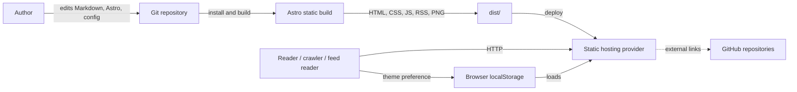
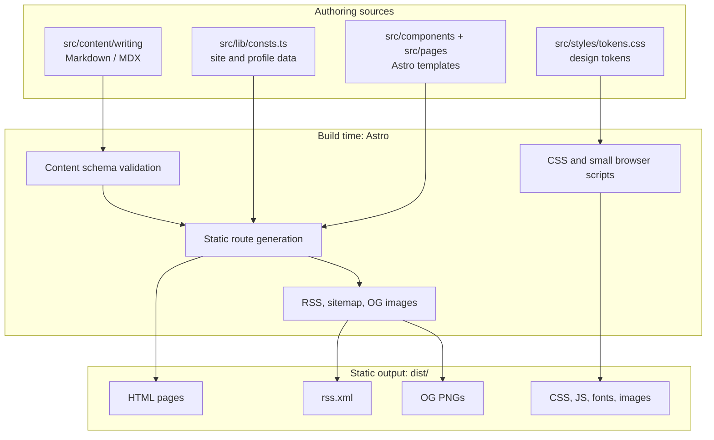
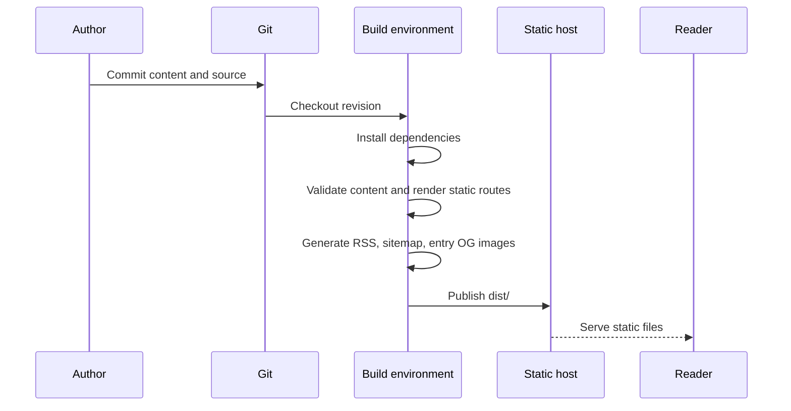

# Strata System Design

**Status:** Current-state baseline, with evolution options  
**Last reviewed:** 2026-10-10  
**Scope:** The Strata website in this repository

This document describes the system that exists today and separates it from possible future directions. It is an evaluation aid, not a commitment to add a CMS, backend, or client-side application.

## 1. Purpose and goals

Strata is a personal portfolio and writing publication. It presents work and writing as one chronological body of evidence, with entries organized by subject (`beat`) and presentation form (`post` or `project`).

The architecture is designed to:

- Publish fast, crawlable pages with minimal browser JavaScript.
- Keep writing and site-specific profile data close to the code and reviewable in Git.
- Generate archive, detail, taxonomy, feed, and social-preview output from shared content.
- Preserve stable public URLs, including redirects from the former `/post` and `/project` paths.
- Keep visual behavior, accessibility, and content presentation in the same deployable unit.

## 2. System context



The repository does not identify a hosting provider. Its documented deployment contract is a static build (`pnpm build`) published from `dist/`; a static host needs no Astro adapter.

## 3. Architecture at a glance



### Main units

| Unit                | Responsibility                                                                     | Current implementation                                                             |
| ------------------- | ---------------------------------------------------------------------------------- | ---------------------------------------------------------------------------------- |
| Content model       | Validate entry metadata and define taxonomy/form values                            | `src/content.config.ts`                                                            |
| Content store       | Versioned Markdown and MDX documents                                               | `src/content/writing/`                                                             |
| Site/profile data   | Navigation, identity, availability, beats, and About-page facts                    | `src/lib/consts.ts`                                                                |
| Pages and routes    | Compose static pages and generate entry/taxonomy paths                             | `src/pages/`                                                                       |
| Presentation        | Shared shell, components, design tokens, and CSS behavior                          | `src/Layout.astro`, `src/components/`, `src/styles/tokens.css`                     |
| Derived outputs     | RSS, sitemap, and entry social cards                                               | `src/pages/rss.xml.js`, Astro sitemap integration, `src/pages/og/[...slug].png.ts` |
| Build configuration | Astro, Tailwind (Vite plugin), MDX, image service, redirects, and Markdown plugins | `astro.config.mjs`, `src/styles/tailwind.css`, `package.json`                      |

## 4. Content and route model

`writing` is the primary content entity. Its schema includes title, date, author, beat, form, categories, tags, draft state, and optional project/repository metadata. `form` distinguishes `post` from `project`; it does not create separate collections or templates. `beat` is one of `frontend`, `backend`, or `trajectory`.

The Astro content schema validates frontmatter during development/build. Markdown and MDX bodies are rendered into static HTML. Draft entries are filtered from public writing routes and derived public output.

| Output                                                       | Source and generation                                                 |
| ------------------------------------------------------------ | --------------------------------------------------------------------- |
| `/`                                                          | Latest published writing plus profile components                      |
| `/writing`                                                   | Published writing archive                                             |
| `/writing/[slug]`                                            | One generated detail page per published entry                         |
| `/beat/[beat]`                                               | One generated page per configured beat, filtering published entries   |
| `/category/[category]`, `/tag/[tag]`                         | Generated taxonomy pages based on writing metadata                    |
| `/about`                                                     | Profile data and authored biography                                   |
| `/rss.xml`                                                   | Published entries, sorted newest-first, with beat and form categories |
| `/sitemap-index.xml` and sitemap files                       | Astro sitemap integration                                             |
| `/og/writing/[slug].png`                                     | Generated entry-specific 1200x630 social card                         |
| `/post`, `/post/[...slug]`, `/project`, `/project/[...slug]` | Redirects to the consolidated writing routes                          |

The schema and several templates have parallel configuration for taxonomy and beats in `src/lib/consts.ts`; when these change, the content schema and presentation maps need to stay aligned. Slugs are public identifiers: changing one can break inbound links unless a redirect is added.

## 5. Build and request flows

### Build and deploy



A content or profile change becomes public after a new build and deployment. There is no runtime content database or request-time rendering requirement in the current design.

### Reader request

1. A reader or crawler requests a URL from the static host.
2. The host returns prebuilt HTML and referenced static assets.
3. CSS handles layout, themes, and most motion. Scroll-linked effects are progressive enhancements with static behavior when unsupported or reduced motion is requested.
4. A small inline script applies the saved/system color theme before paint. `localStorage` stores the user's theme choice.
5. A small amount of browser-side code supports view transitions, the mobile menu, and the signal-field canvas. The canvas respects reduced motion by drawing a still frame.
6. Outbound repository links go directly to GitHub. Repository metadata is intentionally not fetched from the GitHub API.

## 6. Key design decisions

| Decision                                        | Rationale and consequence                                                                                              |
| ----------------------------------------------- | ---------------------------------------------------------------------------------------------------------------------- |
| Static output, no adapter                       | Simple hosting and low runtime complexity; publishing updates require a rebuild/deploy.                                |
| One `writing` collection with `form` and `beat` | Posts and projects share the same archive and detail structure; presentation can vary without splitting content.       |
| Git-backed Markdown/MDX                         | Portable, reviewable, and easy to version; editing/publishing is coupled to repository workflow.                       |
| Generate taxonomy and cards at build time       | Pages are linkable and crawlable without client filtering or request-time APIs; builds do more work as content grows.  |
| Minimal browser JavaScript                      | Keeps content usable without client rendering; theme persistence is browser-local and not synchronized across devices. |
| Static repository cards                         | No API credentials, rate limits, or build network dependency; live stars/languages are intentionally absent.           |
| Preserve legacy redirects                       | Protects existing inbound links while canonicalizing the new route structure.                                          |

## 7. Quality attributes and current constraints

| Attribute       | Current approach                                                               | Constraint / evaluation point                                                                                   |
| --------------- | ------------------------------------------------------------------------------ | --------------------------------------------------------------------------------------------------------------- |
| Performance     | Pre-rendered HTML, optimized assets, few browser scripts                       | Build duration and output size should be measured if content/media volume grows.                                |
| SEO and sharing | Canonicals, metadata, RSS, sitemap, per-entry OG cards                         | `site` in `astro.config.mjs` must match the deployed canonical origin.                                          |
| Accessibility   | Semantic pages, reduced-motion behavior, image alt text, theme contrast tokens | Verify keyboard navigation and assistive-technology behavior when interactive components change.                |
| Reliability     | Static host serves versioned build output; content is validated at build       | Build failure blocks publication; hosting rollback/atomic deploy is a provider concern.                         |
| Security        | No application server, user accounts, or submitted data                        | Dependency and build pipeline security remain relevant; outbound links are external trust boundaries.           |
| Privacy         | No user tracking or server-side personalization is defined here                | Theme is stored locally; hosting-provider access logs and any analytics are outside this repository's contract. |
| Maintainability | Shared schema, templates, components, and design tokens                        | Duplicated filtering/sorting and aligned beat/taxonomy maps may drift as features evolve.                       |
| Availability    | Static output can be served through CDN/static hosting                         | Availability, TLS, domain/DNS, and cache invalidation depend on deployment configuration.                       |

## 8. Known operational considerations

- Run only one Astro dev server at a time: dev servers share the `.astro/` content-collection cache. Astro 7 runs it in the background; stop it with `pnpm astro dev stop`. `.astro/` is generated and git-ignored.
- Restart the dev server after changing `astro.config.mjs`; Astro does not hot-reload this configuration.
- Build the default social card from `scripts/og-card.html` at the documented 1200x630 size when changing its design; keep its alt description in `src/Layout.astro` synchronized.
- Generated entry cards use Satori and `@resvg/resvg-js`; the Vite SSR external/exclude configuration exists to accommodate the native binary during development.
- Font changes affect both browser styling and OG rendering; the OG generator needs a supported font file format.

## 9. Evolution paths to evaluate

These are options, not planned work. Prefer the least operationally expensive option that solves a demonstrated problem.

| Trigger                                                                    | Smallest likely evolution                                                                           | Cost / tradeoff                                                                        |
| -------------------------------------------------------------------------- | --------------------------------------------------------------------------------------------------- | -------------------------------------------------------------------------------------- |
| Content authoring is cumbersome for occasional contributors                | Add content templates, validation scripts, or a repository-backed editor workflow                   | Keeps static architecture; adds authoring conventions and possibly CI checks.          |
| Taxonomy or collection logic becomes inconsistent                          | Centralize published-entry retrieval, ordering, and taxonomy helpers                                | Small code change; must preserve current draft and route behavior.                     |
| Publishing needs preview/review                                            | Add branch/preview builds and protect production deploys                                            | CI/provider configuration; no runtime backend required.                                |
| Content volume makes builds or authoring slow                              | Measure build time first; optimize image/content processing and route generation                    | Avoids premature CMS/database complexity.                                              |
| Nontechnical authors need independent publishing                           | Evaluate a Git-backed CMS before introducing a runtime content API                                  | Adds a service, identity/access controls, preview behavior, and operational ownership. |
| Personalized or frequently changing server data becomes a real requirement | Add a narrowly scoped API or server-rendered island and an Astro adapter                            | Introduces runtime hosting, latency/failure modes, security and observability needs.   |
| Search across a materially larger archive is needed                        | Start with generated client-side search data; evaluate hosted search only if requirements demand it | Index size and privacy/network tradeoffs.                                              |

### Suggested evolution sequence

1. Establish a small CI gate: install from the lockfile, run `astro check`, build, and optionally format-check changed files.
2. Add behavior-focused tests for content filtering, taxonomy normalization, and route/redirect invariants if those rules change often.
3. Centralize repeated published-entry filtering/sorting only when a behavior change or test need justifies it.
4. Revisit the static/runtime boundary only against a concrete requirement (preview workflow, authoring access, personalization, or live data).

## 10. Evaluation questions

Use these to review the design and record decisions before making architectural changes:

- Is Git-backed Markdown still the right source of truth and publishing workflow?
- Is build-time generation acceptable for the expected publishing cadence and archive size?
- Should beat/form definitions have one shared source so the schema and UI cannot drift?
- Which URL and redirect behaviors are compatibility guarantees?
- What deployment provider, preview, rollback, and cache-invalidation guarantees should be part of the documented system?
- Are analytics or search desired, and what privacy constraints would govern them?
- What measurable threshold (build time, content count, authoring friction, or feature need) would justify a CMS or server runtime?

## 11. Local verification

The repository's primary checks are:

```sh
pnpm astro check
pnpm build
```

A successful static build verifies content parsing and route/output generation, but does not by itself verify a deployed domain, host redirects, CDN behavior, or browser accessibility. Those require deployment- and browser-level checks.
