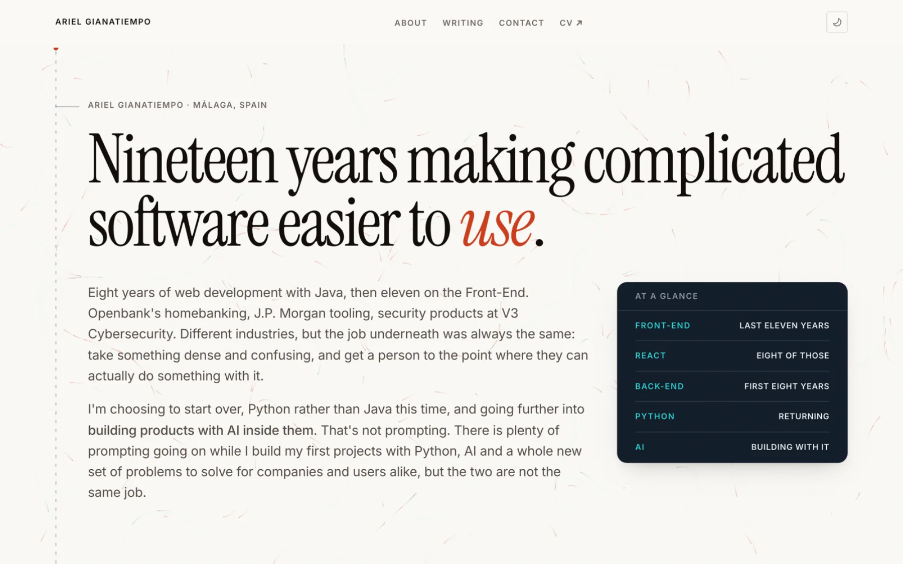
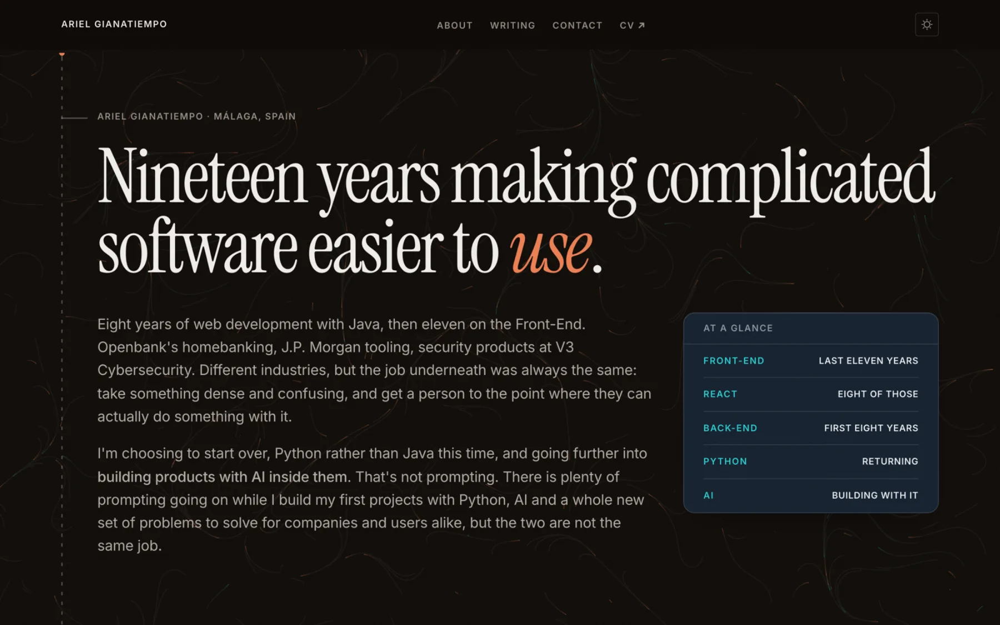

# Strata Visual Identity

**Status:** Current visual direction and extension rules  
**Last reviewed:** 2026-10-10  
**Scope:** The visual language of the Strata website

This guide records why Strata looks the way it does and how to extend that language consistently. It describes roles and constraints, not a second source of CSS values. The implementation lives in [`src/styles/tokens.css`](../src/styles/tokens.css), shared components, and page templates.

| Day                                                     | Night                                                 |
| ------------------------------------------------------- | ----------------------------------------------------- |
|  |  |

## 1. Identity in one sentence

**Strata makes a broad body of technical work readable as one publication by showing the depth of an idea, not sorting people or subjects into visual categories.**

The visual system should make a reader feel oriented, respected, and able to judge the work. It should not make technical material feel like a gated territory or make a varied career look like several unrelated identities being reconciled.

## 2. The central visual idea: depth, not subject

Content has three reading depths. Each depth has a distinct typographic and spatial treatment, so a reader can move from the plain claim to its explanation and then inspect its evidence.

| Depth    | Reader's question                  | Visual voice                                    | Typical content                                 |
| -------- | ---------------------------------- | ----------------------------------------------- | ----------------------------------------------- |
| Claim    | What is the point?                 | Large display serif, open space, plain language | A headline, summary, or framing sentence        |
| Account  | How does it work or what happened? | Body sans, comfortable measure, steady rhythm   | Article prose, biography, explanation           |
| Evidence | What supports that claim?          | Monospaced detail on a compact raised ink panel | Numbers, dates, code, tables, stack, repository |

Color is not the only cue. Type, density, rules, spacing, and panel treatment reinforce the hierarchy. The evidence voice is about the _kind of information_, not whether a topic is frontend, backend, AI, or career history.

## 3. Principles

### Let the work carry the range

Present different subjects as parts of one continuing practice. Use the same page ground, type system, and publication structure across beats. Beat accents may help identify navigation and taxonomy, but must not create separate visual brands for separate technical subjects.

### Lead with a readable claim

Give each page or section a clear human-scale entry point. Use the display voice for the idea, not for decoration. Technical vocabulary belongs in the account or evidence layer when that is where precision is needed.

### Make evidence inspectable, not intimidating

Evidence should be concise, legible, and attached to the claim it supports. Keep it on a bounded panel. Do not turn a whole page section into a dark, full-bleed technical band.

### Prefer editorial structure over interface chrome

Use measure, alignment, whitespace, fine rules, and ordered lists to create hierarchy. Controls should be quiet and recognizable. Avoid adding cards, badges, borders, or decorative flourishes unless they clarify a real relationship or action.

### Make the system survive both themes

Day and night are two expressions of the same semantic roles. Preserve hierarchy through type, structure, and contrast as well as surface lightness; do not define a component as “the light version” or “the dark version.”

## 4. Color roles

Use colors by semantic role, through the existing tokens and utilities. Do not choose a new color ad hoc for a component when a role already exists.

| Role                        | Use                                                        | Guardrail                                                                                 |
| --------------------------- | ---------------------------------------------------------- | ----------------------------------------------------------------------------------------- |
| Ground                      | Main page canvas and ordinary surfaces                     | Keep the page calm and readable; the ground is shared across all subjects.                |
| Primary and supporting text | Claims, prose, labels, metadata                            | Preserve the established hierarchy and readable contrast, including at small label sizes. |
| Accent                      | Links, focus/interaction cues, selected editorial emphasis | Accent is a signal, not a fill for every heading or control.                              |
| Alternate beat signal       | Beat markers where a second subject cue is useful          | Treat it as navigation metadata, not a separate page palette.                             |
| Claim marker                | Selected words in a headline claim                         | Use the dedicated teal brush stroke sparingly; never as a general interface accent.       |
| Evidence ink                | Raised panels for compact, inspectable proof               | Keep contained; its dark/cool color does not mean “AI” or “backend.”                      |
| Rules and borders           | Separate rows, regions, and panel edges                    | Prefer thin structural rules over heavy boxes.                                            |

The current direction pairs a mineral, green-tinted ground with a deep teal primary signal and a quieter leaf-green counterpoint. The claim marker is a light teal stroke on the day ground (a deeper teal under a screen blend at night), reserved for the hand-marked claim treatment, not navigation or large surfaces. The night ground shifts toward blue-green; evidence keeps its separate deep ink plane. Exact values are in [`tokens.css`](../src/styles/tokens.css). Keep token names semantic so component meaning remains stable if the palette changes.

## 5. Typography

The current type family roles are:

- **Instrument Serif:** expressive display voice for claims and editorial headings.
- **Inter:** body voice for prose and interface text.
- **JetBrains Mono:** evidence voice for code-like, numeric, and dense supporting detail.

Use a typeface to communicate a content role, not to color-code a subject. Italics belong to the voice of the writing, not as the default emphasis treatment. Selected headline words use the solid teal brush mark (`.claim-mark`) over the text; keep its rough ends within the marked word. Keep prose at a comfortable reading measure; keep labels and metadata subordinate but legible. The fluid scale and font imports live in `tokens.css`; generated Open Graph cards also load fonts through `src/lib/og.ts`, so font changes must account for both browser rendering and card generation.

## 6. Composition and layout

- **One publication frame:** use the shared shell and align page content consistently. The frame is part of the site's identity across home, archive, About, and article pages.
- **Editorial rhythm:** alternate clear headings, prose, and thinly separated lists. Use whitespace to mark changes in thought rather than wrapping every group in a card.
- **Reading measure:** long-form text should remain narrower than the full page frame; evidence or related material can use the wider column when its content benefits from it.
- **Rules over boxes:** list rows and section dividers use the hairline vocabulary. Reserve framed surfaces for meaningful evidence, not generic content grouping.
- **Stable hierarchy:** page order should make the argument. Do not compensate for unclear content order with extra color or decoration.

Use existing layout utilities such as `.shell`, `.measure`, `.rows`, `.section-head`, and `.shell-river` before adding new layout conventions.

## 7. Signature devices

### The spine

The spine is the recurring through-line: a fine vertical rule in the page gutter, with reading position expressed through its line and a small three-stripe marker. The marker echoes strata without turning the spine into a boundary. Keep it aligned to the content frame and subordinate to the text. Its implementation is `src/components/Spine.astro` and the related rules in `tokens.css`.

### Evidence panels

Evidence panels use the `.evidence` treatment (or the `<Evidence>` component) to gather supporting material. Keep them bounded, dense enough to feel evidentiary, and visually distinct from the page ground. Never use the treatment as a full-bleed section background.

### Signal field

The canvas signal field is ambient texture behind the content, not an illustration or the primary message. Keep it low-contrast and non-interfering. It must remain optional under reduced-motion preferences and must not reduce text legibility. Its implementation is `src/components/SignalField.astro`.

These devices have different jobs: the spine carries continuity, evidence panels carry proof, and the signal field adds a subtle sense of movement. Do not make all three compete for attention in the same viewport.

## 8. Motion and interaction

Motion should support orientation and continuity, not entertain independently of the content.

- Prefer restrained, deliberate movement with no bounce or overshoot.
- Scroll-linked effects may enrich supported browsers, but the static layout must remain complete and understandable without them.
- Honor `prefers-reduced-motion`; persistent canvas animation must stop, and reading-position animation must have a quiet static state.
- Keep keyboard focus visible and interactions identifiable without relying on color or motion alone.
- Avoid smooth-scroll shims, parallax, or attention-seeking movement that competes with reading.

Current timing and easing tokens, plus CSS support/fallback behavior, are maintained in `tokens.css` and the relevant components.

## 9. Theme and accessibility rules

- Theme changes may alter color values, but must not change the meaning of a token or the hierarchy of content.
- Never use color as the sole way to distinguish a beat, state, or type of information; retain labels, text, shape, or structural cues.
- Check text and controls in both themes, including small metadata and muted text. The values in `tokens.css` were chosen with small-text contrast in mind; verify contrast after changing them.
- Preserve semantic HTML, visible focus, useful link names, and meaningful image descriptions.
- Confirm layouts at narrow widths and browser zoom; no signature element should obscure reading or controls.

## 10. Applying the identity

| Surface         | Identity should emphasize                                                       | Avoid                                                                    |
| --------------- | ------------------------------------------------------------------------------- | ------------------------------------------------------------------------ |
| Home            | The central claim, then current writing and a clear next step                   | Turning the page into a dashboard or a catalog of decorative panels      |
| Writing archive | Publication rhythm, date/title scanning, and beat as secondary orientation      | Visually splitting posts and projects into unrelated destinations        |
| Article         | Claim, readable account, then relevant evidence and onward reading              | An intimidating technical masthead or evidence repeated without purpose  |
| About           | Human account first, with career facts and proof available to inspect           | Repeating the same credentials as prose, figures, and endorsements       |
| Social cards    | Recognizable editorial typography, concise title, and a small amount of context | Tiny metadata, dense decoration, or a visual style unrelated to the site |
| Controls        | Clear action, quiet styling, accessible focus and state                         | Unlabeled icon-only actions or controls whose meaning depends on hover   |

## 11. What this identity is not

- Not a different theme for every beat or technical specialty.
- Not a dark-mode-first interface; both themes are first-class.
- Not a generic SaaS dashboard or a portfolio grid of equal-weight cards.
- Not a requirement to place every section inside a panel.
- Not a license to add ambient effects that reduce readability or motion accessibility.

## 12. How to evolve it

Before adding a new visual pattern, answer these questions:

1. Which reading depth or reader need does it serve?
2. Does it reinforce the existing publication identity, or introduce a new visual language?
3. Can the meaning survive both themes, small screens, keyboard navigation, and reduced motion?
4. Can an existing token, component, or layout utility express it?
5. What evidence would show the change improved comprehension or usability?

When a change is accepted, update the implementation and this guide together if it changes a role, principle, or reusable pattern. Update screenshots when they no longer represent the current visual language. Keep exact values in code, and link to the relevant implementation rather than copying token tables into this document.

## 13. Source of truth

| Concern                                 | Source                                                                                    |
| --------------------------------------- | ----------------------------------------------------------------------------------------- |
| Color, type, spacing, and motion tokens | [`src/styles/tokens.css`](../src/styles/tokens.css)                                       |
| Shared page frame and global metadata   | [`src/Layout.astro`](../src/Layout.astro)                                                 |
| Spine                                   | [`src/components/Spine.astro`](../src/components/Spine.astro)                             |
| Signal field                            | [`src/components/SignalField.astro`](../src/components/SignalField.astro)                 |
| Evidence surface                        | [`src/components/Evidence.astro`](../src/components/Evidence.astro)                       |
| OG card typography and rendering        | [`src/lib/og.ts`](../src/lib/og.ts) and [`scripts/og-card.html`](../scripts/og-card.html) |
| Architecture and publishing model       | [`docs/system-design.md`](system-design.md)                                               |
